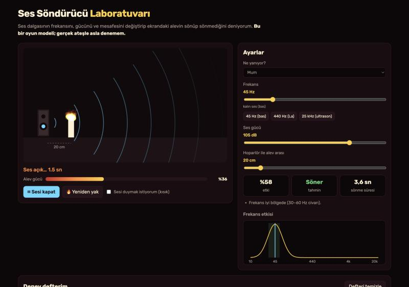
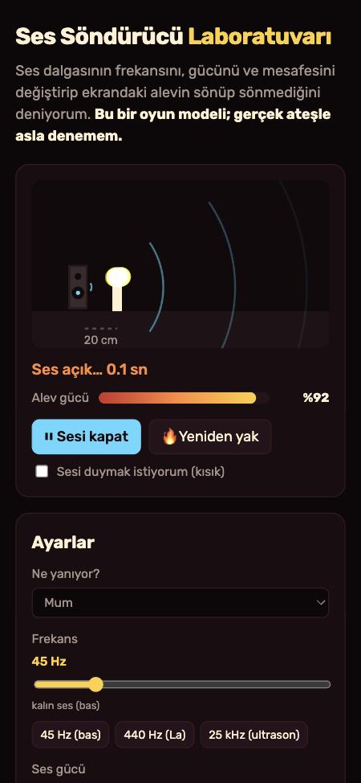

# Ses Söndürücü Laboratuvarı

Aklıma bu geldi: Bugün bir öğrencinin ses dalgasıyla yangın söndüren bir cihaz yapıp madalya aldığını okudum. "Ses gerçekten ateşi söndürebilir mi? Hangi ses?" diye merak ettim. Ben bu laboratuvarı bunun için yaptım. Ekranda bir hoparlör ve bir alev var. Sesin frekansını, gücünü ve hoparlörün alevden uzaklığını değiştiriyorum. Sonra alevin sönüp sönmediğini izliyorum. Bu iki resim, benim çalıştırdığım uygulamanın gerçek ekranları.

**Önemli:** Bu bir oyun modeli. Gerçek yanmayı hesaplamıyor. Ben gerçek ateşle ya da çok yüksek sesle asla deneme yapmam; yüksek ses kulağa zarar verir.

## Ben nasıl kullanıyorum?

1. Ben bu klasörde `python3 -m http.server 8000` çalıştırıyorum. Sonra `http://localhost:8000` açıyorum.
2. Ben "Ne yanıyor?" kısmından mum, küçük alkol kabı ya da kamp ateşi seçiyorum.
3. Ben frekansı, ses gücünü ve mesafeyi kaydırıcılarla ayarlıyorum. Hazır düğmelerle **45 Hz**, **440 Hz** ya da **25 kHz** seçebiliyorum.
4. Ben sağda üç kutuya bakıyorum: **etki**, **tahmin** (söner / sönmez) ve **sönme süresi**. Altında neden öyle olduğunu anlatan kısa notlar çıkıyor.
5. Ben **Sesi aç** diyorum. Hoparlörden halkalar çıkıyor, alev sallanıyor ve alev gücü çubuğu azalıyor. Sönerse duman çıkıyor.
6. İstersem "Sesi duymak istiyorum" kutusunu işaretliyorum. Tarayıcı o frekansı çok kısık sesle çalıyor. 20 Hz'in altını ve 20 kHz'in üstünü zaten duyamıyorum.
7. Ben her denemeyi **Deney defterim** tablosunda görüyorum. Fen projesine yazarken işime yarıyor.

## Ben içeride ne yaptım?

Ben sesin etkisini üç parçaya ayırdım ve çarptım:

- **Frekans:** 45 Hz'de en yüksek olan bir çan eğrisi kullandım. Bunu logaritmik yaptım, çünkü kulağımız da frekansları öyle algılıyor. 30–60 Hz arası güçlü, 440 Hz çok zayıf, 25 kHz neredeyse sıfır.
- **Ses gücü:** 80 dB'nin altı etkisiz, 110 dB tam güç.
- **Mesafe:** 30 cm'de etki yarıya iniyor, 1 metrede çok azalıyor.

Alev gücünü 0 ile 1 arasında tuttum. Her anda alev biraz kendini toparlıyor, ses de onu bastırıyor. Büyük ateş daha hızlı toparlanıyor ve daha zor bastırılıyor. Alev gücü %10'un altına inince söndü sayıyorum. "Tahmin" kutusu aynı hesabı ekranda göstermeden 60 saniye boyunca çalıştırıyor.

Ben `core.mjs` içinde bu hesapları, `app.mjs` içinde çizimi ve sesi tuttum. Hiçbir şey sunucuya gitmiyor. Ben hesap ya da API anahtarı kullanmıyorum. Ayarlarım ve deney defterim sadece bu tarayıcıda duruyor.

## Ben neyi sınadım?

Ben `node test.mjs` komutunu çalıştırdım. **30 kontrol** geçti. Frekans eğrisi 45 Hz'de 1 çıktı; 30 ve 60 Hz'de 0,6'nın üstünde, 440 Hz'de 0,01'in altında kaldı. 110 dB ile 10 cm'den mum **2,3 saniyede** söndü, 1 metreden sönmedi. Aynı yerden 25 kHz ve 440 Hz mumu söndüremedi. Alkol kabı 10 cm'de söndü, 30 cm'de sönmedi. Kamp ateşi en iyi ayarla bile sönmedi. Ses kapalıyken alev kendini toparladı; sönmüş alev kendiliğinden yanmadı.

Ben uygulamayı tarayıcıda da açtım. 45 Hz, 105 dB ve 20 cm ile tahmin **3,6 saniye** idi; mum ekranda **3,7 saniyede** söndü ve duman çıktı. Sonra 25 kHz düğmesine bastım; 4 saniye sonra alev hâlâ **%100** idi ve ekranda "Frekans çok yüksek; alev sadece titriyor" yazdı. İki deneme de deney defterine yazıldı. Telefon boyutunda çizim küçüldü, sayfa yana taşmadı.

Benim sınırlarım var. Buradaki sayılar gerçek ölçüm değil, benim seçtiğim oyun değerleri. Gerçekte oksijen, yakıt türü, rüzgâr ve hoparlörün yapısı da önemli. Bu araç gerçek bir söndürücünün yerine geçmez. İleride gerçek deney videolarındaki süreleri modelle karşılaştırmak isterim.

## Ben bu fikri nereden aldım?

Ben 2015'te George Mason Üniversitesi'nde iki öğrencinin ses dalgasıyla küçük alkol alevlerini söndürdüğünü okudum. Onların denemelerinde yüksek frekanslar alevi sadece titretmiş, **30–60 Hz** arası kalın sesler en iyi sonucu vermiş. Sesin oksijeni yakıttan uzaklaştırdığını düşünüyorlar; bu açıklama başka uzmanlarca kesin doğrulanmış değil. Ayrıca sadece küçük alevlerde denenmiş. Ben bunları [Physics World](https://physicsworld.com/a/dousing-flames-with-low-frequency-sound-waves) ve [Mental Floss](https://www.mentalfloss.com/culture/education/students-invent-fire-extinguisher-uses-sound) yazılarında okudum. Benim modelim onların cihazı değil, sadece bu fikri anlamak için yaptığım bir oyun.

## Ben bugünün kaynaklarına nasıl baktım?

Ben 23 Ekim 2026 saat 10.06 Türkiye vaktinde [GitHub Trending günlük listesine](https://github.com/trending?since=daily) baktım. Gördüğüm 9 repo arasında ilk sırada [php/php-src](https://github.com/php/php-src) vardı ve "bugün 287 yıldız" yazıyordu. Bu, bütün GitHub'ın kesin birincisi olduğu anlamına gelmez. Ben onların kodunu kopyalamadım.

Ben aynı anda [Trends24 dünya listesinde](https://trends24.in/) `松井秀喜` (Hideki Matsui) adını ilk sırada gördüm. Bu liste üçüncü taraf bir anlık görünümdür; bütün günün kesin en çok konuşulan konusu demem.

Ben [Reddit r/popular Top/Today listesinde](https://www.reddit.com/r/popular/top/?t=day) ilk sırada r/meirl'deki [“Meirl”](https://www.reddit.com/r/meirl/comments/1xcdo4p/meirl/) gönderisini gördüm. Dördüncü sırada r/interestingasfuck'ta [ses dalgasıyla yangın söndüren Meksikalı öğrencinin](https://www.reddit.com/r/interestingasfuck/comments/1xcwnp5/mexican_student_invented_an_ultrasonic_fire/) gönderisi vardı. Benim fikrim buradan çıktı. Gönderide "ultrasonik" yazıyordu; ama okuduğum araştırmada en iyi sonucu kalın sesler vermişti. Ben bu farkı da laboratuvarda denenebilir yaptım. Bu tek görünüm, bütün Reddit'in en çok konuşulan konusunu kanıtlamaz.

Ben bu projeyi MIT lisansı ile paylaşıyorum.
